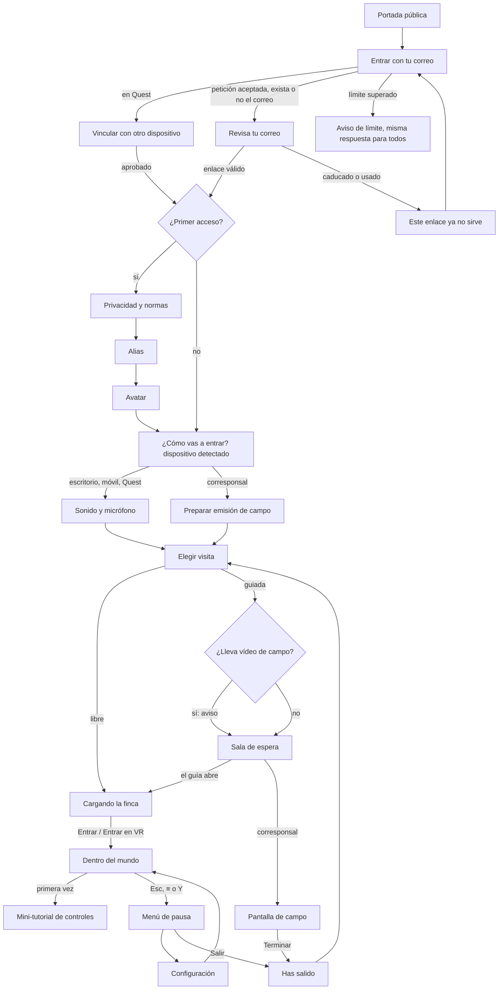

# Cuarenta hazas · Diseño de UX e interacción

> **Estado: aprobada como base por Antonio (29-oct-2026; decisiones 43–47 de [DECISIONS-PENDING](../rumbo/DECISIONS-PENDING.md)); sin implementar y sin probar con personas ni en dispositivos reales.** Define cómo se entra en el mundo y cómo se usa la web multiusuario de [ARQUITECTURA-MULTIUSUARIO](ARQUITECTURA-MULTIUSUARIO.md), con el plan por fases como referencia. La maqueta interactiva está en [`prototipos/ux/index.html`](../../prototipos/ux/index.html) (cómo abrirla: [`prototipos/ux/README.md`](../../prototipos/ux/README.md)). Las decisiones que son de Antonio van marcadas **[DECIDE ANTONIO]**. Lo que no se ha probado se dice en la [última sección](#lo-que-no-está-probado).

## Índice
1. [Principios](#1-principios)
2. [Roles y qué ve cada uno](#2-roles-y-qué-ve-cada-uno)
3. [Mapa de pantallas y flujos](#3-mapa-de-pantallas-y-flujos)
4. [Pantallas de acceso y configuración](#4-pantallas-de-acceso-y-configuración)
5. [Dentro del mundo](#5-dentro-del-mundo)
6. [Privacidad hecha visible](#6-privacidad-hecha-visible)
7. [Accesibilidad](#7-accesibilidad)
8. [Diferencias por dispositivo (resumen)](#8-diferencias-por-dispositivo-resumen)
9. [Decisiones de diseño tomadas](#9-decisiones-de-diseño-tomadas)
10. [Decisiones abiertas](#10-decisiones-abiertas)
11. [Lo que no está probado](#lo-que-no-está-probado)

---

## 1. Principios

1. **El mundo es lo importante; el acceso, lo más corto posible.** De la portada al olivar: correo → enlace → (solo la primera vez: normas, alias, avatar) → dispositivo → visita → carga. Lo que no es imprescindible (ajustes, prueba de micro) se ofrece pero no se exige.
2. **Una sola web, cuatro formas.** Escritorio, móvil del hogar, Meta Quest y móvil corresponsal comparten pantallas y textos; cambian el tamaño, los controles y lo que se dibuja. El dispositivo se **detecta y se propone**, nunca se impone.
3. **La privacidad se ve, no se promete.** Cada vez que algo sale de tu dispositivo (voz) o llega de una persona (vídeo de campo) hay un indicador fijo en pantalla. Los permisos del navegador se piden **solo tras un gesto** y explicando antes para qué.
4. **Honestidad de datos (regla 5 de CLAUDE.md).** Todo dato de una haza lleva su procedencia: *medido*, *deducido*, *ilustrativo* o *modelo*, y de cuándo es. Sin colores que parezcan diagnósticos: el vigor es relativo y sin calibrar.
5. **Comodidad primero en VR (regla 11).** La cámara nunca se mueve sin acción del usuario; giro por saltos y viñeta por defecto; el vuelo y el mirador, apagados de entrada.
6. **Accesible de verdad**: WCAG 2.2 AA en todo lo 2D, todo usable con teclado, objetivos táctiles ≥ 44 px (≥ 56 px en Quest), texto ≥ 16 px, `prefers-reduced-motion` respetado.
7. **Errores que se entienden y que dicen qué hacer.** Ningún «Error 401»: «Este enlace ya no sirve. Pide otro».
8. **Español directo**, de tú, frases cortas. La explotación habla en primera persona del plural («te mandamos», «te avisamos»).
9. **Paleta y tono de la plantilla actual** (`apps/web/plantilla.html`): tierra, verde olivo, turquesa para lo medido, ámbar para lo guardado; tipografía de titulares con serifa. En producción las fuentes irán alojadas en propio (la maqueta usa las del sistema).

## 2. Roles y qué ve cada uno

| Rol | Quién | Ve | Habla | Emite vídeo | Modera | Pantallas propias |
|---|---|---|---|---|---|---|
| **Hogar** | Una persona adulta titular de la cuenta del hogar (los menores entran con ella) | Su haza y las ajenas **en detalle** (decidido), con la lista blanca de campos públicos | Solo en visitas guiadas, al pulsar «Hablar» | Nunca | Solo para sí: silenciar y bloquear | — |
| **Guía** | Personal de la explotación | Todo lo del hogar + quién pide la palabra | Sí | No | Sí: cerrar todos los micros, cerrar uno, dar la palabra, expulsar con motivo | «Abrir la visita» en la sala de espera |
| **Corresponsal** | Personal de la explotación, con Android de campo | Mapa 2D de su zona y quién le sigue | Sí | **Sí, solo este rol** | No | Preparar emisión, pantalla de campo |
| **Administración** | Oficina | Todo, más el panel | Sí | No | Sí | Panel (programar visitas, clips por revisar, registro de moderación, hogares) |

El rol lo da el servidor (el token firmado por la api), no el cliente: la interfaz solo **refleja** permisos, no los concede. Un botón oculto no es una medida de seguridad.

## 3. Mapa de pantallas y flujos

Configuración se alcanza desde la barra superior (tras entrar), desde «¿Cómo vas a entrar?», desde la sala de espera y desde la pausa; su botón «Volver» devuelve a donde estabas (si venías del mundo, dice «Volver a la finca»).

**Sesión.** Una sesión dura lo que decida ADR-0013 (propuesta del plan: cookie HttpOnly/Secure/SameSite, enlace de 15 min de un solo uso). Con sesión viva, abrir la web lleva directo a «Elegir visita», saltando el acceso.

## 4. Pantallas de acceso y configuración

Para cada pantalla: objetivo · contenido · acciones · estados · textos clave · diferencias por dispositivo. «Esc», «Móv», «Quest», «Corr» = escritorio, móvil del hogar, Meta Quest, móvil corresponsal.

### 4.1 Portada pública
- **Objetivo:** explicar en 10 segundos qué es y cómo se entra.
- **Contenido:** nombre, una frase («Un olivar de verdad, en 3D, que se visita desde casa…»), ilustración, botón **Entrar**, «Cómo funciona» en 4 pasos, dos tarjetas (medido/deducido/ilustrativo; privacidad), pie con **créditos de datos**: «LiDAR, MDT y ortofoto PNOA © Instituto Geográfico Nacional (CNIG), CC BY 4.0 · Imágenes Sentinel-2 del programa Copernicus de la UE · Suelos: SoilGrids, ISRIC – World Soil Information, CC BY 4.0», aviso legal, privacidad, declaración de accesibilidad.
- **Acciones:** Entrar · Cómo funciona (ancla).
- **Estados:** con sesión viva, el botón dice «Seguir a la finca». Sin JS: la portada es HTML estático y se lee igual.
- **Dispositivo:** en Quest, botón y texto más grandes; en móvil, la ilustración pasa debajo.
- **[DECIDE ANTONIO]** si hay una vista previa abierta sin cuenta (plan, decisión 5 «¿mundo tras sesión o abierto?»). El diseño funciona en ambos casos: con vista previa, un segundo botón «Echar un vistazo sin entrar» (sin chat ni voz).

### 4.2 Entrar con tu correo (enlace mágico)
- **Objetivo:** pedir el enlace sin contraseña.
- **Contenido:** campo de correo (`type=email`, `autocomplete=email`), pista, botón «Mandarme el enlace»; en Quest, tarjeta «¿Estás en las gafas? Vincular con otro dispositivo».
- **Estados:**
  - *Vacío o mal formado:* error junto al campo, con `aria-invalid` y foco devuelto: «Ese correo no parece completo. Revisa que tenga @ y un dominio».
  - *Enviando:* botón deshabilitado con «Mandando…».
  - *Aceptado:* pasa a «Revisa tu correo». **La respuesta es idéntica exista o no el correo** (no se revela quién tiene cuenta).
  - *Límite de peticiones:* «Has pedido varios enlaces seguidos. Por seguridad, espera unos minutos antes de pedir otro. Si ya te ha llegado uno, úsalo». Mismo texto para cualquier correo. Límite propuesto: por IP y por correo (cifras en ADR-0013).
  - *Error de red:* «No hemos podido conectar. Comprueba la conexión y vuelve a probar».
- **Texto bajo el formulario:** «¿No tienes cuenta? Las cuentas de hogar las da la explotación».

### 4.3 Revisa tu correo
- «Si **x@y** puede entrar en Cuarenta hazas, te acabamos de mandar un enlace. Caduca en **15 minutos** y sirve **una sola vez**.» + «Mira en Correo no deseado. Ábrelo en este mismo dispositivo».
- **Acciones:** Reenviar (deshabilitado con cuenta atrás de 30 s; cuenta para el límite) · Usar otro correo.
- **El correo** (texto propuesto): asunto «Tu enlace para entrar»; cuerpo de dos frases y un botón; «Si no lo has pedido tú, ignora este correo: nadie puede entrar sin él». Sin imágenes remotas ni seguimiento.
- **Enlace caducado:** «Este enlace ya no sirve. El enlace ha caducado: vale 15 minutos desde que lo pedimos». **Enlace usado:** «Este enlace ya se usó. Cada enlace sirve una sola vez; si has entrado desde otro dispositivo, sigue allí». Acción única: «Pedir un enlace nuevo».
- **[SUPUESTO]** el enlace abre la web en el navegador donde se pulsa. Si se pide en el móvil y se abre en el PC, entra el PC: es lo esperado y se dice («Ábrelo en este mismo dispositivo»).

### 4.4 Vincular las gafas (Quest)
- **Por qué:** escribir un correo y abrirlo dentro de las Quest es incómodo. **Propuesta:** las gafas muestran un código corto (`K7Q-4M2`, 5 min); en un móvil u ordenador con sesión, «Configuración → Mis dispositivos → Vincular» lo aprueba; las gafas reciben su propia sesión.
- **Estados:** esperando · aprobado · caducado («El código ha caducado. Te damos otro») · rechazado.
- Alternativa siempre visible: «Prefiero usar el correo». Requiere soporte en la api (encaja en ADR-0013; patrón de «autorización de dispositivo»). **[NO VERIFICADO]** su coste real.

### 4.5 Primer acceso: privacidad y normas
- **Objetivo:** consentimiento informado y en capas, una sola vez.
- **Contenido (capa 1):** Qué guardamos · Qué no guardamos · Voz y vídeo · Menores. **Capa 2:** normas de la comunidad (desplegable) y política completa (enlace).
- **Casillas:** tres obligatorias, **sin marcar por defecto**: «He leído cómo se tratan mis datos», «Acepto las normas de la comunidad», «Soy mayor de edad y esta cuenta es de mi hogar». Una opcional: «Quiero que me aviséis por correo de las visitas guiadas».
- **Error:** resumen arriba con foco: «Para seguir, marca las tres casillas obligatorias».
- **Acción secundaria:** «Ahora no, salir» (cierra la sesión; nada se guarda salvo el correo ya existente).
- **Normas (propuesta):** respeto (hay familias y menores) · no compartir datos personales · no grabar ni difundir las guiadas · lo que se dice de una haza es información, no consejo agronómico · el guía y la administración pueden silenciar o expulsar.
- **Versión de las normas:** si cambian, se vuelven a pedir al entrar (con «qué ha cambiado»).

### 4.6 Primer acceso: alias
- Campo de 3–20 caracteres: letras, números, espacios y guiones. Pista: «Mejor que no sea tu nombre real».
- **Errores:** corto/largo · caracteres no válidos · **correo o teléfono** («No pongas correos ni teléfonos en el alias: lo ve todo el mundo») · reservados (guía, admin, oficina, corresponsal, nombres de la explotación) · **ocupado** («“Mirlo” ya lo usa otro hogar. Prueba con…»).
- Sugerencias de un toque (nombres de aves y árboles).
- **[SUPUESTO]** moderación de alias ofensivos: lista de palabras en servidor + revisión de la administración.

### 4.7 Primer acceso: avatar (estilo bloque)
- Vista previa grande + tres grupos de opciones como radios con nombre visible: camisa (6 colores), sombrero (ninguno, paja, gorra), tono de piel (5). Botón «Al azar». Se puede cambiar desde Configuración → Cuenta.
- Sin rasgos de género ni edad; nada que identifique.
- **Quest:** si se edita dentro de VR, la vista previa es un espejo delante; las opciones, en el panel.

### 4.8 ¿Cómo vas a entrar? (dispositivo y modo)
- **Detectado** (marcado y rotulado «Detectado»): escritorio, móvil, Quest (navegador Oculus/Meta) o móvil corresponsal (Android + rol corresponsal).
- **Opciones:** «En pantalla, con teclado y ratón» · «En el móvil, táctil» · «Inmersivo, con gafas VR» · «Corresponsal de campo» (deshabilitada si el rol no lo es, con la razón: «Tu cuenta no tiene este permiso»).
- **WebXR:** el botón «Entrar en VR» solo aparece donde `navigator.xr.isSessionSupported('immersive-vr')` responde sí. Si se elige VR sin WebXR: «Este navegador no ofrece realidad virtual (WebXR). Puedes entrar en pantalla igualmente».
- **Acciones:** Seguir · Ajustar antes de entrar.

### 4.9 Sonido y micrófono
- **Paso 1, ¿se oye?:** «Probar el sonido» → campana → «¿Has oído una campana? Sí / No». No → consejos (volumen, modo silencio, pestaña silenciada; en Quest, botón lateral).
- **Paso 2, micrófono:** se explica antes de pedir: «Lo usarás solo cuando pulses “Hablar” en una visita guiada. Nunca se abre solo y, mientras está abierto, lo verás indicado en pantalla». Botón **«Permitir el micrófono»** (el gesto que desencadena el aviso del navegador) y **«Ahora no»** al mismo nivel.
- **Estados:** sin pedir · concedido (medidor de nivel en vivo y selector de micrófono) · **denegado** («El micrófono está bloqueado. Podrás oír y escribir en el chat, pero no hablar» + cómo desbloquearlo según el navegador del dispositivo) · **sin micrófono** · rechazado por la persona (sin reproche; se puede activar luego).
- Esta pantalla **no bloquea**: se puede seguir en cualquier estado.
- **[SUPUESTO]** Safari en iPhone puede volver a pedir permiso en cada sesión; se dice si ocurre.

### 4.10 Preparar la emisión de campo (corresponsal)
- Lista de comprobación con un botón por permiso, cada uno pedido con su gesto: **ubicación precisa** (muestra precisión, p. ej. ± 6 m), **cámara trasera** (720p máx.), **micrófono**, **pantalla encendida** (Wake Lock), **cobertura de subida** (prueba: «2,1 Mb/s: vídeo a 360p»), **batería** (estimación de minutos de emisión).
- **Obligatorio:** «He avisado a la cuadrilla de que hoy hay emisión de campo» y «Encuadraré copa y suelo; si aparece una persona, pauso la cámara».
- Si la subida es insuficiente: «Sin cobertura para directo aquí. Puedes grabar clips cortos que se subirán después y revisará la oficina».

### 4.11 Configuración
Pestañas (patrón ARIA con flechas): **Gráficos · Sonido · Voz · Accesibilidad · Controles · Comodidad VR · Cuenta**. Se guarda al momento, por dispositivo (lo de cuenta, en servidor).

| Pestaña | Ajustes |
|---|---|
| Gráficos | Calidad **Automática** (recomendada; muestra el perfil detectado y baja sola si el fotograma se alarga, como el adaptador de VR ya existente) / Baja / Media / Alta · distancia de detalle de olivos · ahorro de batería (30 fps) · contador de rendimiento (= `?debug`) |
| Sonido | Volumen general, ambiente, voces · voces según la distancia (el guía se oye siempre) |
| Voz | Cómo se abre el micro: **pulsar para abrir y cerrar** (defecto, más accesible) o mantener para hablar · dispositivo · reducción de ruido · ir a la prueba |
| Accesibilidad | Tamaño del texto 100–200 % (también paneles del mundo y VR) · alto contraste · movimiento (sistema / reducido / normal) · nombres sobre avatares siempre visibles · subtítulos de la voz del guía (**propuesta sin probar**) · descripción para lector de pantalla («Estás en la haza 7; cerca: Mirlo») |
| Controles | Sensibilidad de mirada · invertir eje vertical · velocidad · lista de teclas · ver la ayuda |
| Comodidad VR | Giro por saltos 30° (defecto) / 45° / suave · viñeta suave (defecto) / fuerte / apagada · desplazamiento: palanca + teletransporte / solo teletransporte · **vuelo y mirador: desactivados de entrada** · postura de pie / sentado · mano principal |
| Cuenta | Alias y avatar · mis dispositivos (vincular) · avisos por correo · descargar mis datos · borrar la cuenta |

### 4.12 Elegir visita
- **Visita libre** (siempre disponible): «Ahora · Chat de texto · Sin voz · N personas dentro». Botón grande.
- **Visitas guiadas programadas:** título, cuándo, guía (alias), plazas, y en lista lo que trae: «Voz abierta con guía», «Vídeo de campo en directo desde el móvil de una persona de la explotación» (si lo hay), «No se graba» **[pendiente: grabación]**. Acciones: «Apuntarme» o, si empieza en < 15 min, «Ir a la sala de espera».
- Al entrar en una guiada **con vídeo**, aviso modal: «Esta visita lleva vídeo de campo en directo. Verás imágenes del olivar desde el móvil de una persona de la explotación. El directo no se graba. Tu voz solo se oye cuando pulses “Hablar”».
- **Estados:** sin guiadas («No hay visitas guiadas programadas. Cuando la explotación programe una, aparecerá aquí») · llena («Completa · avisarme si queda sitio») · cargando · error.
- **Por rol:** guía ve «Eres el guía» y «Abrir la sala de espera»; corresponsal ve solo las suyas y no la libre; administración ve además la tarjeta del panel.

### 4.13 Sala de espera (guiada)
- Título, hora y guía; cuenta atrás; **lo que hay en esta visita** (voz, vídeo, moderación, silenciar para ti); estado del micro propio; lista de quién espera (alias y dispositivo).
- Acciones: Probar el micro · Configuración · Salir de la sala. **Guía:** «Abrir la visita ahora». **Corresponsal:** «Salir al campo».
- Estados: antes de hora · «Es la hora. El guía abrirá enseguida» · cancelada («El guía ha cancelado la visita») · sala llena.

### 4.14 Cargando la finca
- Barra de progreso con `role=progressbar` y texto de fase: «Terreno y ortofoto · Olivos cercanos · Lindes de las hazas · Conectando con la visita» + «12 de 24 teselas». Rejilla de teselas como pista visual (decorativa).
- **Consejos rotativos** que enseñan la honestidad de datos («Los troncos y las ramas son ilustrativos…»).
- **Fin:** botón **Entrar**; en Quest con WebXR, **«Entrar en VR»** (principal) y «Entrar en pantalla»: el paso a inmersivo exige gesto del usuario, por eso no se entra solo.
- **Error de tesela:** «No se pudo traer una parte de la finca (tesela 7 de 24)» → Reintentar · Entrar con lo cargado (lo que falta se ve en gris) · Bajar la calidad y reintentar. **Red lenta:** lo dice en el estado. Cancelar siempre disponible.

## 5. Dentro del mundo

Con menos detalle que el acceso: es la pantalla que más cambiará al probarla.

### 5.1 HUD
- **Arriba a la izquierda (estado):** «En: haza 7 · Las Tejas (tuya)» o «En: camino» · tipo de visita («Visita guiada · voz abierta · no se graba») · **● Tu micro está abierto** (rojo, solo mientras lo está) · **EN DIRECTO · Vídeo de campo** (mientras hay emisión) · «Sin conexión · reconectando…».
- **Arriba a la derecha (paneles):** Haza (H) · Chat (T, con contador de no leídos) · Gente (P, con número) · Menú (Esc). En móvil, barra inferior de cuatro botones; en Quest, todo eso vive en el **panel flotante** (botón Y), con la misma estructura.
- **Abajo:** minimapa (escritorio), barra de voz (centro), cruceta (móvil), marca de lo ilustrativo cuando proceda.
- **Avisos efímeros** (máx. 3, 6 s, `aria-live=polite`): moderación, llegada de vídeo, mensajes con el chat cerrado.
- El HUD es el mismo con `?debug` salvo el contador (regla 7 de la skill `interaccion`).

### 5.2 Panel de haza («mi haza» y hazas ajenas)
- Se abre con H, tocando una haza o desde el panel VR; muestra por defecto **la haza en la que estás** y sigue tu paseo; con «Ver otra haza» (lista) se fija en otra.
- **Ajenas en detalle (decidido):** mismos campos que la propia, sin titular. Texto: «Haza de otro hogar. Ves sus datos públicos; no quién es su titular».
- **Campos (lista blanca propuesta, ADR-0014):** superficie (medido) · olivos contados (medido) · altura mediana de copa (medido, LiDAR) · vigor hoy (deducido, Sentinel-2, relativo y sin calibrar) · último trabajo y fecha (OlivarTrack, sin personas ni kilos) · suelo (modelo SoilGrids a 250 m, «no es una analítica») · troncos y ramas (ilustrativo). Cada uno con su etiqueta de procedencia y la fecha del dato.
- **Acciones:** «Llévame allí» (teletransporte; en pantalla con transición corta, en VR con fundido, nunca vuelo de cámara) · «Pregunta a la oficina sobre esta haza» («La contesta una persona de la explotación; no es al momento. No incluyas datos personales»). Las preguntas son **entrada no confiable** para la api y el agente.

### 5.3 Chat
- Un chat por visita. Mensajes con alias y rol (el guía, destacado). Por mensaje: **Bloquear** (dejas de ver y oír a esa persona). Avisos del sistema en cursiva («El guía ha cerrado los micros»).
- Límite de 280 caracteres; filtro de correos y teléfonos en servidor **[SUPUESTO]**; límite de ritmo.
- Conservación: «Se borra al terminar» **[DECIDE ANTONIO: plazo de conservación del chat]**. Las preguntas sobre hazas sí se guardan (van por el panel de haza, no por el chat).

### 5.4 Gente
- Lista: tú (con estado de micro), el guía («modera la visita»), corresponsal, hogares; alias, rol y dispositivo.
- **Cualquiera:** Silenciar para mí · Bloquear («solo te afecta a ti; nadie se entera»).
- **Guía/administración:** Cerrar todos los micros / Abrir los micros · Dar la palabra · Cerrar su micro · **Expulsar** (confirmación con motivo; queda en el registro de moderación y en `auditoria`). Lo hace el servidor (`RoomService`), no el cliente.
- Las peticiones de palabra («✋») aparecen arriba en la lista del guía **[pendiente de diseñar en detalle]**.
- **Quest (hecho, I5; no probado en unas Quest):** en el panel flotante (Y), sección **Gente**: una fila por persona que se ve (alias, a pie / en quad / con el dron, distancia; las cuatro más cercanas) con **«Ir con»** pulsable con el rayo y el gatillo (pulso háptico, fundido y de pie a 2,5-4 m de ella, mirándola; el panel se cierra al llegar). Sin presencia, «Solo tú». La ficha de una baliza en VR dice quién está y tiene **«Ir a esta baliza»** y «Cerrar» pulsables; se abre al acercarse o apuntando a su columna de luz. Detalle en [VR.md](VR.md).

### 5.5 Voz en guiadas
- Barra de voz: estado («Micro cerrado» / «Te están oyendo» / «El guía ha cerrado los micros» / «Tu micro no está disponible: escribe en el chat») + **Hablar** (alterna por defecto; «mantén V» o mantener pulsado si se elige) + **Pedir la palabra**. Guía: «Cerrar todos los micros».
- **Siempre empieza cerrado**, se cierra al abrir el menú, al perder la conexión y al salir. En visita libre la barra solo dice «Visita libre: sin voz. Usa el chat».
- **Quest:** hablar con **grip derecho mantenido** o el botón del panel **[propuesta: el grip derecho está libre hoy en `29_vr.js`; sin probar]**.

### 5.6 Vídeo del corresponsal
- En el mundo: **pantalla flotante** sobre su avatar, con «EN DIRECTO» y su cono de visión; chip fijo en el HUD. Si pausa la cámara: «Cámara en pausa». En el móvil del corresponsal: mapa 2D con su posición (con precisión), su cono y quién le sigue; GPS, rumbo, subida, batería; vista de cámara; **Empezar/Parar emisión · Pausar cámara · Micro · Grabar clip diferido · Terminar**.

### 5.7 Menú de pausa y salir
- Esc (escritorio), ≡ (móvil), Y→Menú (Quest). Diálogo modal: **Volver a la finca** · Configuración · Controles y ayuda · Pasar a VR (si hay WebXR y no estás en VR) · Créditos y fuentes de datos · Informar de un problema · Panel de administración (solo admin) · **Salir de la visita** (con confirmación: «Se cerrará tu micro y dejarás de aparecer en la finca»).
- «La visita sigue mientras miras el menú»: no es una pausa del mundo compartido; se cierra tu micro.
- **Has salido:** «Tu micro está cerrado y ya no apareces en la finca. La posición de tu avatar no se guarda» → Volver a las visitas · Cerrar sesión.

### 5.8 Primera llegada: mini-tutorial
Diálogo breve, una vez (y en Menú → Controles y ayuda):
- **Escritorio:** W A S D o flechas: andar · arrastrar: mirar · clic en haza o H: datos · T: chat · V o botón: hablar · Esc: menú · con el Dron (E): clic en el suelo marca la llegada, Intro o L aterriza allí (§5.9).
- **Móvil:** cruceta: andar · arrastrar: mirar · pellizcar: acercar · tocar haza · barra de abajo · ≡: menú · con el Dron: toque corto en el suelo marca la llegada, «Aterrizar aquí» (§5.9).
- **Quest:** palanca izq.: andar (grip izq.: correr) · palanca der. ← →: girar 30° · palanca der. ↑ y soltar: teletransporte (volando o en el mirador, rayo recto y bajas de pie al anillo, §5.9) · gatillo der.: elegir · Y: panel · X: viñeta · grip der.: hablar (propuesta). Nota: «Si te mareas, activa la viñeta o usa solo teletransporte».
- **Corresponsal:** emitir · pausar cámara · clip diferido.

### 5.9 Ir a un punto desde el aire: el anillo de llegada (VR y Dron)
El mismo gesto en las dos formas: **se marca el punto con un anillo ámbar en el suelo y luego se pide bajar**; el salto va con un **fundido corto (~0,3 s)**, nunca con vuelo de cámara, y se aparece **de pie en el anillo** (apartado 0,55 m de los troncos, a la altura del suelo), andando. Sin anillo, «bajar» hace lo de siempre. Una sola pieza en el código: `apps/web/motor/12b_llegada.js` (rayo → suelo de la CPU, también con `?escena=tiles`; el anillo crece con la distancia, ≈ 1,4°, entre 0,4 y 30 m).

| Forma | Marcar la llegada | Bajar allí | Sin anillo |
|---|---|---|---|
| **Quest**, volando (A) o en el mirador (B) | Palanca derecha ↑ **mantenida**: rayo recto del mando al suelo y anillo; el anillo sigue al rayo. Si el rayo no toca suelo dentro de la finca o cae por detrás de la mirada (> ~96°), no hay anillo (el rayo se queda corto y tenue) | **Soltar** la palanca: fundido a negro, de pie en el anillo, modo andar | Soltar no hace nada; A o B salen del vuelo o del mirador como siempre |
| **Quest**, andando | (lo de siempre) palanca derecha ↑: arco azul | Soltar: salto al punto de caída | — |
| **Escritorio**, con el Dron (E o «Dron») | **Clic** en el suelo (≤ 6 px de movimiento y ≤ 0,4 s); otro clic lo mueve; arrastrar no lo pone | **Intro** o **L**, o el botón «Aterrizar aquí» de la cruceta | «Aterrizar» (o Intro/L) guarda el Dron donde estás |
| **Móvil**, con el Dron | **Toque corto** en el suelo (≤ 12 px y ≤ 0,4 s); otro toque lo mueve; arrastrar o mantener no lo pone | Botón **«Aterrizar aquí»** (ancho de la cruceta, 44 px de alto) | «Aterrizar» guarda el Dron |

Comodidad: la cámara no se mueve hasta que se suelta o se pulsa; el rayo es una línea fina semitransparente y el anillo es solo un aro (no tapa); sin anillo por detrás del usuario. **No probado en unas Quest, ni en un iPhone ni en un Android** (solo Chrome sin pantalla con WebXR simulado y ratón).

## 6. Privacidad hecha visible

| Momento | Qué se ve |
|---|---|
| Portada | «No hay vídeo de los hogares, nunca. La voz solo en guiadas, con guía que modera. La cuenta es de una persona adulta» |
| Primer acceso | Resumen en capas + casilla «Soy mayor de edad y esta cuenta es de mi hogar»; avisos por correo opcionales y desmarcados |
| Antes de pedir el micro | Para qué se usa, cuándo, y que se verá cuando esté abierto; «Ahora no» al mismo nivel |
| Elegir visita | Cada guiada dice si lleva voz y vídeo de campo, y si se graba |
| Entrar en una guiada con vídeo | Aviso modal específico |
| Dentro | Chip rojo **● Tu micro está abierto**; chip **EN DIRECTO · Vídeo de campo**; «no se graba» en el chip de la visita |
| Hazas ajenas | Sin titular; solo campos de la lista blanca; sin personas, GPS, texto libre ni kilos |
| Corresponsal | Aviso a la cuadrilla y encuadre obligatorios; «Pausar cámara» siempre a mano; clips diferidos revisados por la oficina antes de publicarse |
| Salir | Confirmación de que el micro se cierra y la posición no se guarda |
| Cuenta | Descargar mis datos · borrar la cuenta |

**Menores.** La cuenta es del adulto (casilla obligatoria). Un menor entra con esa cuenta, bajo su responsabilidad; en visita libre no hay voz; se recomienda alias no real. **[DECIDE ANTONIO]** si se quieren «perfiles del hogar» (varios alias bajo una cuenta adulta) con voz desactivada para perfiles infantiles; el plan cita consentimiento del adulto para < 14 años (RGPD/LOPDGDD) **[NO VERIFICADO jurídicamente]**.

## 7. Accesibilidad

Objetivo **WCAG 2.2 AA** en todo lo 2D (acceso, configuración, HUD, paneles). En VR no hay norma equivalente: se aplican las mismas ideas (texto grande, contraste, sin parpadeos, alternativas a gestos finos).

- **Estructura:** un `h1` por pantalla; al cambiar de pantalla el foco va a ese `h1` y un `aria-live` anuncia el título; enlace «Saltar al contenido»; `lang="es"`.
- **Formularios:** etiqueta visible en cada campo; errores en texto junto al campo, enlazados con `aria-describedby`, `aria-invalid` y foco al primer error; nada depende solo del color (2.2: 3.3.7 «entrada redundante» — el alias y el correo no se vuelven a pedir).
- **Teclado:** todo operable; orden lógico; foco visible de 3 px (2.4.7 y 2.4.11 *foco no tapado*: los paneles no tapan el elemento enfocado); pestañas con flechas, Inicio y Fin; diálogos nativos (`<dialog>`) con Esc; atajos de una letra **solo** cuando el foco está en el mundo, nunca en un campo (2.1.4).
- **Lectores de pantalla:** botones con nombre accesible; `aria-pressed`/`aria-expanded` en conmutadores; regiones `status` para avisos; la escena tiene una descripción textual y el panel de haza da la misma información que la vista; modo «descripción para lector» anuncia haza y gente cercana.
- **Táctil:** objetivos ≥ 44 × 44 px (2.5.8 pide 24 px; se usa 44), ≥ 56 px en Quest; ningún gesto de varios dedos imprescindible (2.5.1); arrastrar tiene alternativa por botones (2.5.7: la cruceta, «Llévame allí»).
- **Contraste:** paleta de la plantilla comprobada para texto: tinta sobre fondo y blanco sobre verde olivo superan 4,5:1; el ámbar y el turquesa solo como borde o fondo (no como color de texto) porque sobre fondo claro no llegan a 4,5:1. Modo oscuro con tokens propios. Alto contraste opcional.
- **Movimiento:** `prefers-reduced-motion` y ajuste propio: sin animaciones de entrada, sin vuelos de cámara; el «teletransporte» usa corte.
- **Texto:** 16 px base, escalable al 200 % sin perder contenido (1.4.4, 1.4.10 a 320 px de ancho). **En VR:** el tamaño de texto del ajuste se aplica al panel; mínimo propuesto ≈ 1,5° de ángulo visual por línea **[SUPUESTO; probar en casco]**.
- **Audio:** nada importante solo por sonido (los avisos de moderación también se escriben); subtítulos del guía como propuesta.
- **Tiempo:** el enlace de 15 min y el código de 5 min se pueden renovar sin perder nada (2.2.1).

## 8. Diferencias por dispositivo (resumen)

| | Escritorio | Móvil del hogar | Meta Quest | Móvil corresponsal |
|---|---|---|---|---|
| Acceso | Correo | Correo | **Vincular con código** (o correo) | Correo + rol |
| Primer acceso | Igual | Igual, una columna | Igual, texto 19 px base y botones 56 px | Igual |
| Antes del mundo | Sonido y micro | Sonido y micro | Sonido y micro | **Preparar emisión** (GPS, cámara, Wake Lock, cobertura, aviso a cuadrilla) |
| Carga | Entrar | Entrar | **Entrar en VR** (gesto) / Entrar en pantalla | — |
| Moverse | WASD/flechas, ratón | Cruceta, arrastrar, pellizcar | Palancas, saltos de 30°, teletransporte | Andando por el olivar |
| Paneles | Lateral derecho | Hoja inferior | Panel flotante (Y) | Pantalla única 2D |
| Hablar | Botón o V | Botón | Grip der. o panel (propuesta) | Micro siempre a mano |
| Calidad | Auto (Media) | Auto (Baja/Media), ahorro de batería | Perfil VR propio (ADR-0005) | 3D no se dibuja |

## 9. Decisiones de diseño tomadas

1. **Sin contraseña:** enlace mágico de 15 min, un uso, respuesta idéntica exista o no el correo, límite con el mismo texto para todos.
2. **Vincular gafas con código** como camino principal en Quest (propuesta a confirmar con la api).
3. **Primer acceso en tres pasos** (normas, alias, avatar) y solo una vez; casillas obligatorias sin premarcar.
4. **Dispositivo detectado y propuesto**, editable; modo corresponsal visible pero deshabilitado con motivo para otros roles.
5. **La prueba de micro no bloquea** y el permiso se pide con explicación previa y gesto.
6. **Micro: pulsar para abrir y cerrar por defecto** (más accesible que mantener), con «mantener» como opción; siempre empieza cerrado y se cierra al abrir el menú.
7. **Indicadores fijos** de micro abierto y de vídeo en directo; «no se graba» en el chip de la visita.
8. **Panel de haza que sigue tu paseo** y permite fijar otra; ajenas con los mismos campos que la propia y sin titular.
9. **Etiqueta de procedencia en cada dato** (medido, deducido, ilustrativo, modelo, OlivarTrack).
10. **Un solo cajón con pestañas** (Haza, Chat, Gente) en vez de tres ventanas: un único lugar en escritorio, hoja inferior en móvil, panel en VR.
11. **Silenciar y bloquear son personales y silenciosos**; la moderación con efecto para todos es solo del guía y la administración, con motivo y registro.
12. **Entrar en VR siempre por botón** tras la carga (exigencia de WebXR y regla de comodidad); vuelo y mirador apagados de entrada.
13. **Menú que no pausa el mundo** compartido, pero cierra tu micro.
14. **Créditos de datos** en la portada y en el menú del mundo.

## 10. Decisiones abiertas

| Decisión | Por qué importa | Quién |
|---|---|---|
| **Marca**: logotipo, si «Cuarenta hazas» es el nombre del producto o solo del proyecto, relación visual con Cano & Damas | Portada, correo, pestaña del navegador | **[DECIDE ANTONIO]** · aplazada (decisión 44): nombre provisional hasta antes de abrir a gente real |
| **Grabar las visitas guiadas** (DECISIONS-PENDING #10) | Textos «no se graba», aviso de grabación, consentimiento | ✅ decisión 10: no se graba el directo |
| **Proveedor de correo** del enlace mágico | Entregabilidad (que no caiga en spam), remitente, coste | ✅ decisión 15: SMTP de OVH |
| **Mundo tras sesión o con vista previa abierta** (plan, decisión 5) | Botón extra en portada | ✅ decisión 16: sin sesión, solo la portada |
| **Qué campos de una haza ajena** y si se muestra el alias del hogar titular | Panel de haza (ADR-0014) | ✅ decisión 13 |
| **Qué es una «haza»** (40 / 32 / 37) | Nombres y número de hazas en el panel y el minimapa | ✅ decisión 12: tabla propia, la asigna la oficina |
| **Plazo de conservación del chat** | Texto del chat y de privacidad | ✅ decisión 40: no se guarda |
| **Perfiles de menores** bajo la cuenta adulta | Primer acceso, voz | ✅ decisión 45: no por ahora; se reabre con asesoría junto a la EIPD de F3 |
| Textos legales finales (responsable, base legal, EIPD ampliada) | Política y casillas | Antonio + asesoría |
| Mapeo de «hablar» en Quest | Tutorial y panel VR | decisión 47: grip derecho **provisional**; se decide al probarlo en casco |
| Vincular las gafas | Acceso en Quest | ✅ decisión 46: código corto aprobado desde el móvil u ordenador con sesión |
| Subtítulos de voz | Accesibilidad | Técnica, tras ver coste |

## Lo que no está probado

- **Nada se ha probado con personas** (ni hogares, ni guía, ni corresponsal). Los textos y flujos son hipótesis.
- **Nada en dispositivos reales**: ni iPhone, ni Android de campo, ni Meta Quest. La maqueta solo se ha abierto en Chrome de escritorio (headless) a 1280 × 800 y 390 × 844, sin errores de consola.
- **Accesibilidad:** comprobación automática mínima (nombres accesibles, tamaño de objetivos en Configuración) y contraste calculado sobre los tokens; **no** se ha pasado un auditor (axe/Lighthouse) ni un lector de pantalla real (NVDA, VoiceOver, TalkBack).
- **WebXR, permisos y Wake Lock** son simulados: la maqueta no llama a `navigator.xr`, `getUserMedia`, `geolocation` ni `wakeLock`.
- **Comodidad VR** (giro, viñeta, panel flotante, texto a distancia, grip para hablar): sin sesión en casco.
- **Flujo de vincular gafas** y **límite de enlaces**: en la maqueta, simulados. Implementados desde el 29-oct-2026 en `apps/web/portada/` y la api ([contratos/sesion.md](../../contratos/sesion.md)); probados solo con Chrome headless (y el agente de usuario del navegador de Meta), **no** en unas Quest ni en un iPhone.
- **Voz espacial, moderación y vídeo**: no hay LiveKit en la maqueta.
- **La escena** de la maqueta es un dibujo SVG, no el gemelo: no dice nada de rendimiento.
